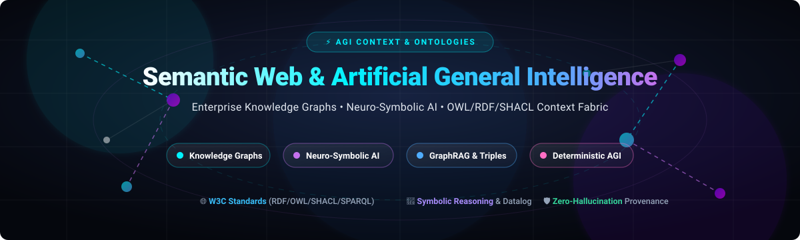

# 🧠 Awesome Semantic Web & Artificial General Intelligence (AGI) 🌐

  <strong>A curated directory of enterprise SaaS platforms and leading open-source frameworks bridging Knowledge Graphs, W3C Semantic Standards (RDF/OWL/SHACL/SPARQL), Neuro-Symbolic Reasoning, and Deterministic Context Layers for Artificial General Intelligence.</strong>

---

## 📑 Table of Contents
- [📌 Overview &amp; Key Concepts](#-overview--key-concepts)
- [📊 Sector Overview &amp; Market Dynamics](#-sector-overview--market-dynamics)
- [🏢 SaaS &amp; Commercial Hosted Platforms](#-saas--commercial-hosted-platforms)
- [💻 Open-Source Frameworks &amp; Tools](#-open-source-frameworks--tools)
- [🤝 How to Contribute](#-how-to-contribute)
- [💖 Support &amp; Sponsorship](#-support--sponsorship)
- [⭐ Star History](#-star-history)
- [⚖️ Disclaimer &amp; License](#️-disclaimer--license)

---

## 📌 Overview & Key Concepts

The convergence of the **Semantic Web** and **Artificial General Intelligence (AGI)** forms the foundation for reliable, explainable, and hallucination-free autonomous systems. While modern Large Language Models (LLMs) provide probabilistic linguistic fluency, they lack deterministic world models, causal reasoning, and ontological consistency.

This repository tracks key tools that implement:
* 🕸️ **Formal Knowledge Graphs &amp; Ontologies:** W3C-standardized modeling via RDF, RDFS, OWL 2, and SHACL validation.
* ⚡ **High-Throughput Triple &amp; Quad Stores:** Deterministic storage engines executing SPARQL 1.1 graph queries across billions of triples.
* 🧩 **Neuro-Symbolic AI:** Hybrid architectures combining neural representations with formal first-order logic, Datalog, and Rete reasoning engines.
* 🛡️ **Context &amp; Provenance Fabrics:** Verifiable data lineage using W3C PROV-O to ground multi-agent AGI workflows in transparent truth.

---

## 📊 Sector Overview & Market Dynamics

The global semantic web and enterprise knowledge graph market is valued at approximately **$3.5 billion in 2026** (projected to reach over **$11.8 billion by 2032** at an aggressive **CAGR of ~22.4%**), driven predominantly by enterprise demand for **GraphRAG**, neuro-symbolic reasoning layers, and deterministic context architectures to eliminate LLM hallucinations.

The sector exhibits a **moderately fragmented, dual-tier market structure**: while infrastructure giants and database incumbents (such as Microsoft, Amazon Neptune, and Neo4j) capture broad enterprise data fabric commitments, the semantic reasoning and ontology management tier remains highly competitive and fragmented among specialized knowledge graph platforms (GraphDB/Graphwise, Stardog, Cambridge Semantics/Altair, PoolParty) and rapidly advancing open-source frameworks providing open standard compliance (W3C RDF/OWL/SHACL).

---

## 🏢 SaaS & Commercial Hosted Platforms

The following enterprise platforms offer managed cloud hosting, automated data extraction, semantic search, and cognitive inference. The table is ranked by company scale (valuation / annual revenue).

| Rank | Platform | Valuation / Revenue | Starting Tier Pricing | Free Tier Limits / Trial Limit | Key Semantic &amp; AGI Capabilities |
| :---: | :--- | :--- | :--- | :--- | :--- |
| 1 | [Wikimedia Enterprise / Wikidata Cloud](https://wikidata.org) | **$240M Budget** *(Wikimedia Foundation FY26 annual budget)* | **Free / Custom for Enterprise API** (Standard SPARQL/LOD is $0; commercial bulk enterprise streaming pricing custom) | **Free Forever**: Unlimited public web access &amp; standard SPARQL endpoint access (rate-limited via standard User-Agent compliance) | Multilingual collaborative structured knowledge base; billions of statements powering global AI entities and open linked data. |
| 2 | [Wolfram|Alpha](https://wolframalpha.com) | **~$120M Revenue** *(Wolfram Research estimated ARR)* | **$5.00/mo** (Pro Tier billed annually at $60/yr; or $9.99/mo monthly) | **Free Forever**: Unlimited basic computational queries; excludes step-by-step reasoning, file/data uploads, and prolonged compute time limits | Computational knowledge engine pairing curated symbolic ontologies, exact algorithmic reasoning, and natural language understanding. |
| 3 | [Cambridge Semantics (Anzo)](https://cambridgesemantics.com) | **~$80M Valuation** *(Acquired by Altair Engineering, April 2024)* | **Enterprise Quote / Custom** (Billed annually per core/cluster; contact sales) | **30-Day Free Trial**: Full-featured enterprise evaluation sandbox available upon sales qualification request | Enterprise data fabric, AnzoGraph DB massively parallel processing (MPP) graph database, and automated semantic ETL pipelines. |
| 4 | [Ontotext GraphDB](https://ontotext.com) | **~$65M+ Revenue** *(Merged into Graphwise / Sirma Group ecosystem)* | **$1,500/yr** (GraphDB SE/Enterprise entry licenses or cloud marketplace hourly/annual commitments) | **Free Forever**: GraphDB Free license includes full RDF/SPARQL &amp; reasoning engines with a hard limit of **2 concurrent queries** | Enterprise W3C RDF triple store, semantic inference with OWL/SHACL, visual SPARQL workbench, and LLM GraphRAG grounding. |
| 5 | [Stardog](https://stardog.com) | **~$50M Valuation** *($45M+ total venture funding raised)* | **$1.50/hr or Enterprise Contract** (Stardog Cloud custom cluster plans or AWS Marketplace hourly/annual pricing) | **Free Forever**: Stardog Cloud Free tier allows up to **1,000,000 graph edges (triples)** across **3 databases** on shared cloud infrastructure | Virtualized knowledge graph platform with native OWL reasoning, SHACL constraint validation, and Voicebox natural language search. |
| 6 | [PoolParty Semantic Suite](https://poolparty.biz) | **~$35M Valuation** *(Part of Graphwise group)* | **$1,900/mo** (Managed cloud entry configuration or ~$21,000/yr annual server license) | **30-Day Guided Trial**: Proof-of-concept environment and read-only sample taxonomy server test access available upon qualification request | Cloud semantic middleware specializing in SKOS taxonomy management, automated text classification, and knowledge graph engineering. |
| 7 | [Diffbot](https://diffbot.com) | **~$3.5M ARR / ~$50M Valuation** *(Bootstrapped &amp; VC-backed)* | **$299/mo** (Startup Tier includes 250,000 extraction &amp; NLP credits/mo) | **Free Forever**: **10,000 credits/month** (extract 1 page = 1 credit; KG entity export = 25 credits; 1 concurrent thread, no credit card required) | AI-driven computer vision and NLP that crawls the public web, synthesizing an autonomous Knowledge Graph containing billions of entities. |
| 8 | [TopQuadrant (TopBraid EDG)](https://topquadrant.com) | **~$4.1M Revenue** *(TopQuadrant Inc. private ARR estimate)* | **Enterprise Quote** (Annual modular subscription based on user roles and functional modules) | **30-Day Evaluation License**: Request-based vetted free trial granted following enterprise use case review (5–7 business days approval) | Comprehensive data governance, taxonomy management, and semantic modeling software built natively on W3C SHACL and RDF. |
| 9 | [Cyc Platform (Cycorp)](https://cyc.com) | **~$5.2M Revenue** *($10M venture funding &amp; DARPA R&amp;D contracts)* | **Custom B2B / B2G Enterprise License** (Per-seat &amp; project consulting contract pricing) | **30-Day Evaluation Trial**: Case-by-case corporate evaluation access granted under mutual NDA/PoC agreement | Legendary symbolic AI and commonsense reasoning platform encompassing millions of formal axioms and higher-order inference logic. |
| 10 | [DBpedia Cloud](https://dbpedia.org) | **~$500K Budget / InfAI Association** *(Supported by InfAI Leipzig &amp; OpenLink)* | **Free / Community Sponsored** (Commercial custom endpoints and Databus enterprise integration support available) | **Free Forever**: Public SPARQL endpoints and Databus downloads available at no charge with standard non-commercial rate limits | Groundbreaking open linked data infrastructure continuously extracting structured knowledge from Wikipedia into linked RDF triples. |

---

## 💻 Open-Source Frameworks & Tools

This section highlights open-source repositories for local triple stores, neuro-symbolic reasoning frameworks, ontology editors, and graph-native memory systems for autonomous agents. Sorted descending by GitHub_Stars_Count.

| Project | GitHub_Stars | Category | Core Tech Stack | Description |
| :--- | :---: | :--- | :--- | :--- |
| **[GraphRAG](https://github.com/microsoft/graphrag)** |  | Graph-Enhanced LLM RAG | Python | Modular graph-based Retrieval-Augmented Generation system extracting structured knowledge graphs from raw documents. |
| **[Cognee](https://github.com/topoteretes/cognee)** |  | Semantic Agent Memory | Python | Open-source semantic memory engine combining vector search and knowledge graphs to provide LLMs with persistent, interconnected recall. |
| **[Semantica](https://github.com/semantica-agi/semantica)** |  | AGI Semantic Layer | Python / Rust | Graph-native semantic and context fabric for AI agents with OWL/SHACL ontologies, deterministic Rete/Datalog reasoning, and W3C PROV-O audit trails. |
| **[Z3 Theorem Prover](https://github.com/Z3Prover/z3)** |  | Symbolic Logic &amp; SMT | C++ | High-performance Satisfiability Modulo Theories (SMT) solver widely used for formal verification, automated theorem proving, and neuro-symbolic verification. |
| **[PyTorch-BigGraph](https://github.com/facebookresearch/PyTorch-BigGraph)** |  | Knowledge Graph Embeddings | Python / PyTorch | Distributed system for learning entity and relation embeddings on massive, multi-billion-node graph-structured datasets. |
| **[RDFLib](https://github.com/RDFLib/rdflib)** |  | Semantic Web SDK | Python | Foundational Python package for parsing, serializing (Turtle, JSON-LD, RDF/XML), manipulating, and querying RDF triples with SPARQL 1.1. |
| **[OpenCog Framework](https://github.com/opencog/opencog)** |  | Cognitive Architecture &amp; AGI | C++ / Scheme | Integrated artificial general intelligence framework featuring the AtomSpace hypergraph knowledge representation and cognitive reasoning agents. |
| **[Scryer Prolog](https://github.com/mthom/scryer-prolog)** |  | Logic Programming | Rust | Modern, safe ISO Prolog implementation written in Rust, ideal for building symbolic logic layers and deterministic constraint solvers. |
| **[AmpliGraph](https://github.com/accenture/ampligraph)** |  | KG Representation Learning | Python / TensorFlow | Open-source Python library for representation learning and relational link prediction on large-scale Knowledge Graphs. |
| **[Oxigraph](https://github.com/oxigraph/oxigraph)** |  | SPARQL Graph Database | Rust | Fast, lightweight graph database implementing W3C RDF and SPARQL standards, built on RocksDB with native Python and JavaScript bindings. |
| **[PyKEEN](https://github.com/pykeen/pykeen)** |  | Knowledge Graph Embeddings | Python / PyTorch | Comprehensive framework for training, evaluating, and deploying knowledge graph embedding models (TransE, ComplEx, RotatE, etc.). |
| **[Protégé Desktop](https://github.com/protegeproject/protege)** |  | Ontology IDE | Java | The industry-standard open-source ontology editor and knowledge management system supporting OWL 2, RDF, and description logic reasoners. |
| **[Apache Jena](https://github.com/apache/jena)** |  | Semantic Framework | Java | Complete framework for building Linked Data applications, offering the TDB triple store, ARQ SPARQL query engine, and Fuseki server. |
| **[Soufflé](https://github.com/souffle-lang/souffle)** |  | Datalog Reasoning Engine | C++ | High-performance Datalog compiler translating declarative logic rules into parallel C++ code for rapid deductive inference and static analysis. |
| **[OpenCog AtomSpace](https://github.com/opencog/atomspace)** |  | Hypergraph Database | C++ / Scheme | Weighted, labeled metagraph and semantic network knowledge store powering the OpenCog cognitive architecture. |
| **[OpenLink Virtuoso (Open-Source)](https://github.com/openlink/virtuoso-opensource)** |  | Multi-Model Triple Store | C / C++ | High-performance hybrid database engine combining relational tables and billion-scale RDF graph capabilities; powers the public DBpedia endpoint. |
| **[Blazegraph](https://github.com/blazegraph/database)** |  | RDF/SPARQL Graph DB | Java | Ultra-scalable RDF/SPARQL database supporting up to 50 billion triples per node; historical backend for the Wikidata Query Service. |
| **[neosemantics (n10s)](https://github.com/neo4j-labs/neosemantics)** |  | Neo4j RDF Integration | Java | Neo4j plugin enabling direct import, export, and SHACL validation of RDF ontologies within property graph models. |
| **[QLever](https://github.com/ad-freiburg/qlever)** |  | SPARQL Engine | C++ | Extremely fast SPARQL search engine capable of querying over 100 billion triples on single commodity servers; current modern backend for Wikidata. |
| **[OWL API](https://github.com/owlcs/owlapi)** |  | Java Ontology API | Java | Leading Java API and reference implementation for creating, manipulating, and serializing W3C OWL 2 ontologies. |
| **[LinkML](https://github.com/linkml/linkml)** |  | Linked Data Modeling | Python | Extensible data modeling language compiling human-readable YAML schemas directly to OWL, SHACL, JSON-Schema, and Python dataclasses. |
| **[OpenNARS](https://github.com/opennars/opennars)** |  | Non-Axiomatic Logic AGI | Java | Research implementation of the Non-Axiomatic Reasoning System (NARS), an adaptive symbolic AGI reasoning architecture. |
| **[Eclipse RDF4J](https://github.com/eclipse-rdf4j/rdf4j)** |  | RDF Framework | Java | Robust Java framework providing efficient RDF parsing, transactional quad stores, SPARQL 1.1 querying, and SHACL constraint checking. |
| **[pySHACL](https://github.com/RDFLib/pySHACL)** |  | SHACL Validator | Python | Pure-Python W3C Shapes Constraint Language (SHACL) validator with advanced SHACL-JS and OWL constraint extensions. |
| **[ROBOT](https://github.com/ontodev/robot)** |  | Ontology CLI &amp; CI/CD | Java | Command-line tool and library for automating biomedical and enterprise ontology release workflows, reasoning, and validation. |
| **[Hyperon MeTTa](https://github.com/trueagi-io/hyperon-experimental)** |  | Neuro-Symbolic AGI Lang | Rust / Python | Core language and experimental interpreter for OpenCog Hyperon, unifying symbolic pattern matching, metagraph rewriting, and neural models. |
| **[OWL-RL](https://github.com/RDFLib/OWL-RL)** |  | Forward-Chaining Deductive Engine | Python | Lightweight rule-based forward-chaining reasoner implementing OWL 2 RL and RDFS axiomatic expansions on top of RDFLib graphs. |
| **[OpenBioLink](https://github.com/OpenBioLink/OpenBioLink)** |  | Biomedical Knowledge Graphs | Python | Standardized benchmark framework for training and evaluating knowledge graph link prediction algorithms on complex biological networks. |
| **[Wikibase Core](https://github.com/wikimedia/wikibase)** |  | Collaborative KG Software | PHP / JavaScript | Software suite powering Wikidata, enabling organizations to deploy and curate flexible, collaborative linked knowledge graphs. |
| **[HermiT Reasoner](https://github.com/phillord/hermit-reasoner)** |  | Description Logic Reasoner | Java | Robust OWL 2 DL description logic reasoner based on the hypertableau algorithm, verifying ontology consistency and subsumption. |

---

## 🤝 How to Contribute

Contributions are warmly welcomed! Help make this the most comprehensive and up-to-date guide for Semantic Web and AGI builders.

1. 🍴 **Fork the repository** on GitHub.
2. 🌿 **Create a new branch**: `git checkout -b feature/add-new-semantic-tool`.
3. 📝 **Edit `README.md`**: Follow the established table formatting for SaaS platforms or Open-Source repositories.
4. ⭐ **Include metrics**: Provide specific starting tier pricing, free tier/trial limits, company scale, and Stars_Badges.
5. 🚀 **Submit a Pull Request** with a concise description of the tool and its relevance to Semantic Web and AGI architectures.

---

## 💖 Support & Sponsorship

If you find this curated collection valuable for your research, enterprise engineering, or AGI exploration, please consider supporting the project:

* 🌟 **Star this repository** to improve visibility and help other researchers discover it.
* 🍴 **Fork and share** with colleagues in the Semantic Web and Knowledge Graph communities.
* ☕ **Buy a coffee or sponsor ongoing maintenance**: Support via the [GitHub Sponsors Dashboard](https://github.com/sponsors/ishandutta2007).

---

## 📈 Star History

---

## ⚖️ Disclaimer & License

* **Disclaimer**: This is a community-curated collection for educational and architectural research purposes. Mention of specific vendors or open-source projects does not constitute formal endorsement. Always evaluate ontology consistency and provenance safety before production deployment in autonomous systems.
* **License**: Released under the [MIT License](LICENSE).

---

  Curated with ❤️ by <a href="https://github.com/ishandutta2007">Ishan Dutta</a> and the global Knowledge Engineering &amp; Neuro-Symbolic AI community.

